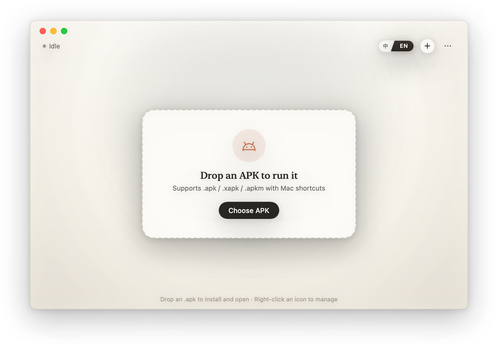
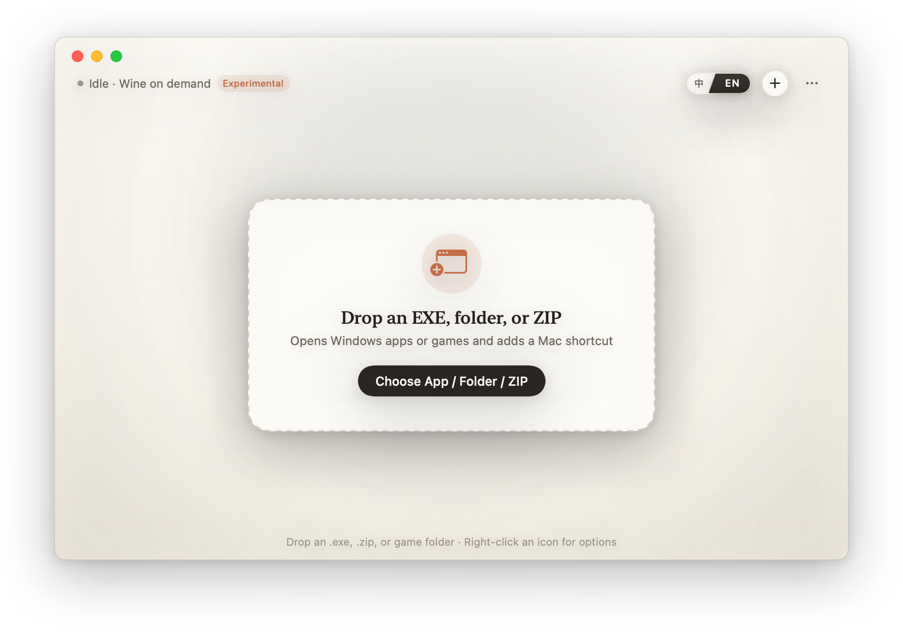

# APK in macOS

**English** | [简体中文 (Chinese README)](README_ZH.md)

A minimalist, warm-parchment Android app shelf for **Apple Silicon (ARM64) Macs**: **zero popups — just drop and run**. Drag any `.apk` / `.xapk` / `.apkm` onto the shelf to inspect its real icon and name inline, install into a strictly isolated Android 15 ARM64 environment, create a double-clickable Mac `.app` shortcut in `~/Applications/APK in macOS/`, and launch it in an independent Retina-scaled macOS window.

> Also ships an optional companion Windows extension [**EXE in macOS**](#optional-companion-extension-exe-in-macos) (~1.5 MB standalone bundle sharing the same `ShelfKit` UI), tuned for indie/doujin RPGs, visual novels, and lightweight Windows utilities. Android-only users pay zero disk or runtime overhead.



---

## Key Features

- **Zero-Popup Drop & Run**: Drag `.apk` / `.xapk` / `.apkm` files onto the shelf. It extracts the real app icon and label inline, brings up the isolated Android 15 ARM64 runtime quietly, creates a standalone `.app` shortcut (also launchable via `apkinmacos://open?pkg=`), and opens right away.
- **Independent Resizable Retina Windows**: Each Android app runs inside its own `VirtualDisplay` and hardware-accelerated H.264 stream — run multiple apps side by side, resize freely, scroll with trackpad, type, and paste with `⌘V`.
- **`.xapk` & `.apkm` Split-APK + `.obb` Support**: Unpacks bundles automatically, filters compatible `arm64-v8a` splits, installs via `adb install-multiple`, and pushes `.obb` payloads to `/sdcard/Android/obb/`.
- **Drop Files Directly into App Windows**: Drag images, PDFs, or archives into any running Android window to push them straight into `/sdcard/Download/` with a media-scanner broadcast.
- **Lightweight Background Policy**: Defaults to `3 GB` RAM and disables unneeded preinstalled Google background apps (preserving Play Services, keyboard, and WebView). Lowers emulator priority after 30s with no open windows and saves a snapshot + sleeps after 5 idle minutes (`⋯ → Performance` lets you customize or wake anytime).
- **Strictly Isolated AVD & Setup Guide**: Keeps an isolated `APKInMacOS_Shelf35` AVD (port `5576`) inside `~/Library/Application Support/APKInMacOS/` without touching `~/.android/avd`. Displays a one-click copy `brew` / `sdkmanager` setup card if no Android SDK is installed yet.
- **Warm Parchment UI + Page-Flip Bilingual Switch**: Warm off-white vellum palette (`#F6F3EB`) at a spacious `820×540` default size with an interactive diagonal `中 / EN` page-flip toggle in the top bar (also switchable from `Language / 语言` in the menu bar).

---

## Optional Companion Extension: EXE in macOS

Built in the same repository on top of `ShelfKit`, `EXE in macOS` (`dist/EXEInMacOS.app`, *Experimental*) is packaged separately at ~1.5 MB with shortcuts in `~/Applications/EXE in macOS/` — keeping the core Android runner clutter-free while letting you play indie Windows titles when needed.



- **Best Fit**: Indie / doujin RPGs (RPG Maker MV / MZ / XP / VX / VXAce), visual novels (TyranoBuilder, Ren'Py, Wolf RPG, Kirikiri, etc.), Unity indie games, and portable lightweight Windows utilities.
- **Dual-Engine Routing (Built to Eliminate Lag & Input Issues)**:
  - **NW.js / RPG Maker MV·MZ / TyranoBuilder / Construct**: Automatically extracts cover art and game titles and routes to **native Apple Silicon ARM64 NW.js** (60 FPS Metal GPU rendering, `<1%` idle CPU, native CJK rendering, and native keyboard input), with a right-click toggle to switch back to Wine anytime.
  - **Unity / Classic RPG Maker XP·VX·VXAce / Ren'Py / Win32**: Runs via Wine Stable 11.0 + **DXVK-macOS** (DirectX 10/11 → Metal 3, async shaders, `esync`), auto-injecting `-force-d3d11` for Unity and reading `Game.ini` titles for classic RPG Maker.
- **Locale Switcher, Smart ZIP Decoding & Crash Diagnostics**:
  - Drop `.exe`, `.msi`, `.zip`, or whole game folders. `.zip` extraction decodes UTF-8 → Shift-JIS (CP932) → GB18030 automatically to prevent mojibake paths and skips uninstallers/crash handlers to find the primary `.exe`.
  - Auto-selects `ja_JP.UTF-8` (Shift-JIS) for Japanese RPGs or lets you switch any Wine app between Simplified Chinese, Japanese, Traditional Chinese, and English from the right-click **Locale** menu, backed by `ArialUnicode.ttf` font linking.
  - Diagnoses quick crashes (missing VC++ Runtime, missing RPG Maker RTP, unsupported DX12), installs Microsoft **VC++ Redistributable (x64)** on demand via `⋯ → Performance & Compatibility`, supports right-click renaming & log inspection, and stops `wineserver` automatically after 2 idle minutes.
- **Compatibility Boundaries**: Not intended for kernel anti-cheat/driver-protected desktop messengers (WeChat/QQ/DingTalk), heavy commercial suites (Adobe / Office / CAD), or heavy DirectX 12 AAA games (Apple's D3DMetal cannot be redistributed with open-source software).

---

## Installation & First Run

1. Download the standalone archive(s) you need from [GitHub Releases](https://github.com/Pybsama/apk-in-macos/releases):
   - `APKInMacOS-arm64.zip`: **APK in macOS** primary app (~1.8 MB)
   - `EXEInMacOS-arm64.zip`: **EXE in macOS** optional Windows companion (~1.5 MB)
2. Unzip and drag the `.app` bundle(s) into `/Applications`.
3. **First-Launch Gatekeeper Note**: Releases are ad-hoc signed without paid Apple notarization. If macOS says the app is *"damaged"* or *"cannot verify the developer"*, clear the quarantine attribute in Terminal:

```bash
xattr -cr /Applications/APKInMacOS.app
# If you also use the Windows extension:
xattr -cr /Applications/EXEInMacOS.app
```

### Requirements
- **Mac**: Apple Silicon (M1/M2/M3/M4), macOS 14.0 or later.
- **Android Runtime**: Android SDK & Emulator installed locally (if missing, `APKInMacOS.app` shows a one-click copy setup command on the empty shelf).

---

## Project Layout

```text
Sources/
├─ ShelfKit/       Shared warm parchment theme, page-flip toggle, Mac shortcut builder, L10n & utilities
├─ APKRuntime/     Android SDK discovery, APK/XAPK/APKM inspection, H.264 virtual display & ADB engine
├─ WineRuntime/    Pure-Swift PE parser, smart-encoding ZIP/folder resolver, Wine/NW.js/DXVK manager
├─ APKShelfApp/    APK in macOS primary app target
└─ EXEShelfApp/    EXE in macOS optional Windows companion target (Experimental)
```

---

## Build & Package

```bash
# Run all unit tests
swift test

# Build the primary app only (dist/APKInMacOS.app)
BUILD_CONFIG=release ./script/package_app.sh

# Build both the primary app and the Windows extension (dist/APKInMacOS.app + dist/EXEInMacOS.app)
BUILD_CONFIG=release ./script/package_all.sh

# Without Android SDK installed locally (reuses committed Resources/display-bridge.jar):
BUILD_CONFIG=release SKIP_BRIDGE_BUILD=1 ./script/package_all.sh
```

---

## License & Third-Party Runtimes

- Source code in this repository is licensed under the [MIT License](LICENSE).
- No Wine, NW.js, or DXVK binaries are bundled in this repository or `.app` builds. When not already present locally, runtimes are downloaded on demand and verified via `SHA-256` on first use:
  - **Wine Stable** (LGPL-2.1+, packaged by [Gcenx/macOS_Wine_builds](https://github.com/Gcenx/macOS_Wine_builds))
  - **DXVK-macOS** (zlib/libpng License, from [Gcenx/DXVK-macOS](https://github.com/Gcenx/DXVK-macOS))
  - **NW.js macOS ARM64** (MIT License, from [nwjs.io](https://nwjs.io/))
